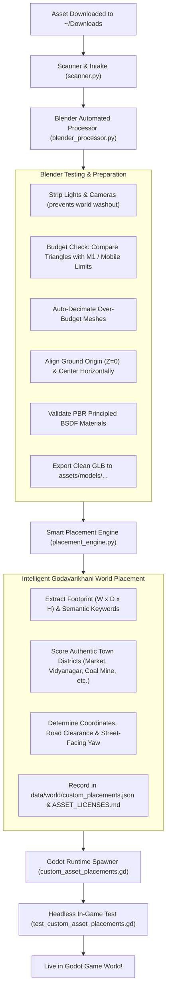

# ManaOoru 3D Asset Import & Smart Placement Pipeline

A fully automated, intelligent pipeline that bridges downloaded 3D assets (`.blend`, `.obj`, `.fbx`, `.gltf`, `.glb`, or `.zip` archives) in your laptop's `Downloads` folder directly into the **ManaOoru** Godot world.

---

## 1. Quick Start: The Prompt-First Workflow

Whenever you download a 3D asset into `~/Downloads`, you do not need to manually write Blender scripts, adjust coordinates, or code Godot nodes. Simply tell the AI agent:

> **"Setup this in our game"**  
> *(or "Setup the chai stall I just downloaded", "Setup ~/Downloads/banana_plant.obj in our game")*

The AI agent will immediately:
1. Scan your `~/Downloads` directory and identify the newest 3D model or archive.
2. Inspect, test, clean, and optimize it in Blender (headless).
3. Evaluate its physical dimensions and semantic tags to determine the best location in Godavarikhani.
4. Export the clean `.glb`, register it in `data/world/custom_placements.json`, and log it in `ASSET_LICENSES.md`.
5. Trigger Godot import and run headless verification to confirm the asset is placed, grounded, and collidable.

---

## 2. CLI Tool Reference

You can also run the pipeline manually from your terminal:

```bash
# Auto-detect the newest 3D model or archive in ~/Downloads
python3 tools/asset_pipeline/pipeline.py

# Process a specific file in ~/Downloads
python3 tools/asset_pipeline/pipeline.py --input "broken bricks.fbx"

# Specify a custom display name
python3 tools/asset_pipeline/pipeline.py --input "Banana_Plant_01.obj" --name "Vidyanagar Banana Tree"

# Manually specify a district location override
python3 tools/asset_pipeline/pipeline.py --input "hotel_couch.fbx" --location sai_leela_hotel

# Disable automatic polygon decimation (if you want original high-poly mesh)
python3 tools/asset_pipeline/pipeline.py --input "hero_car.glb" --no-decimate
```

---

## 3. Pipeline Stages & Architectural Flow



---

## 4. Godavarikhani Location Reference

The smart placement engine evaluates which district best matches the asset:

| District Key | Location Name | Best Fit Assets | Target Coordinates & Yaw |
|---|---|---|---|
| `market_street` | **Market Street Pedestrian Verges** | Food carts, vegetable/fruit stalls, chai stands, *haathgaadi*, panipuri carts, market canopies | Map $(108, -32)$<br>Yaw $180^\circ$ (faces street) |
| `vidyanagar_residential` | **Vidyanagar Colony Road No. 2** | Banana trees, garden plants, residential houses, compound gates, domestic Sintex water tanks, parked family SUVs | Map $(318, -330)$<br>Yaw $-45^\circ$ (driveway) |
| `coal_mine` | **Coal Mine OCP 5 Incline Worksite** | Broken bricks, rock/rubble piles, industrial mining equipment, haul dumpers, warning signs, heavy pylons | Map $(1540, 1380)$<br>Yaw $35^\circ$ (quarry edge) |
| `godavari_bridge` | **Godavari River Bridge Approach** | Metal crash barriers, speed limit signs, highway trucks, bridge lights, road dividers | Map $(755, -3290)$<br>Yaw $90^\circ$ (bridge shoulder) |
| `ambedkar_park` | **Dr. B.R. Ambedkar Park** | Park benches, ornamental trees, stone fountains, floral shrubs, recreational statues | Map $(-185, -120)$<br>Yaw $0^\circ$ (park border) |
| `sai_leela_hotel` | **Hotel Sai Leela & Restaurant** | Modular sofas, lounge chairs, courtyard pool accessories, dining tables, planters | Map $(-220, 180)$<br>Yaw $0^\circ$ (lobby / patio) |
| `chowrasta` | **Chowrastha Central Junction** | Traffic police booths, auto rickshaws, municipal streetlights, commercial billboards, town benches | Map $(15, 12)$<br>Yaw $90^\circ$ (junction curb) |
| `bus_station` | **TGSRTC Godavarikhani Bus Station** | Passenger buses, waiting sheds, route signage, ticket counters | Map $(-720, 240)$<br>Yaw $45^\circ$ (bus bay) |

---

## 5. Performance & Quality Assurance Rules

1. **Camera & Light Stripping:** Blender lights and suns are automatically deleted before export. In Godot, imported lights cause scene burnout (turning the world blinding white).
2. **Triangle Budget Enforcement:**
   - Props / Furniture / Debris: $\le 15,000$ triangles.
   - Vehicles: $\le 50,000$ triangles.
   - Buildings: $\le 60,000$ triangles.
3. **Ground-Height Probing:** The Godot runtime spawner (`scripts/world/custom_asset_placements.gd`) probes the actual terrain height with `world.ground_height(Vector2(x, z))` and applies a $+0.02\text{ m}$ elevation offset so objects never float or clip into the ground.
4. **Visibility Range Rule:** `visibility_range_end` is strictly applied to child `GeometryInstance3D` nodes rather than the root `Node3D`, preventing Godot engine crashes.
5. **Static Collisions:** Proper colliders (`trimesh`, `box`, or `cylinder`) are automatically generated so vehicles, pedestrians, and the player can physically interact with the asset.

